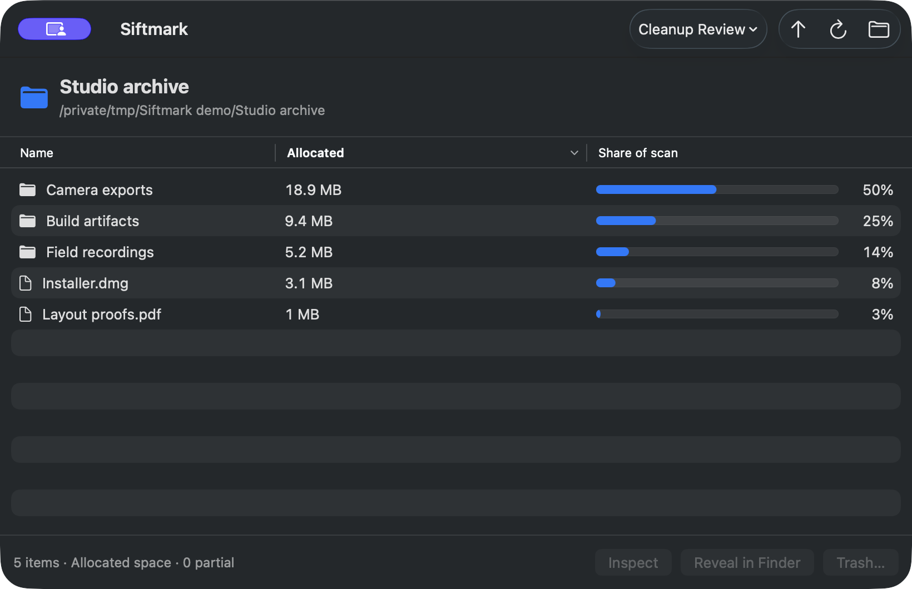
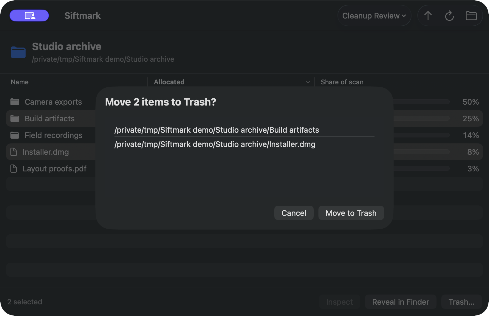

# Siftmark

Find the folder that ate your disk space. Siftmark is a small native Mac app that measures a folder, shows where its bytes went, and lets you review files together before moving them to Trash. The SwiftUI window and Rust scanner run on your Mac.



## Get it running

**[Download Siftmark for Apple Silicon](https://github.com/alexgtmbot/siftmark/releases/download/v1.1.0/Siftmark-1.1.0-arm64.zip)** for macOS 14 or later. Unzip the download, drag Siftmark into Applications, and open it. The release is signed by GTM Bot Inc. and notarized by Apple.

### Build from source

You’ll need Apple’s Xcode Command Line Tools and a current stable Rust toolchain with Cargo. Run `xcode-select --install` if you need the Apple tools. [Install Rust](https://rustup.rs/)

```sh
git clone https://github.com/alexgtmbot/siftmark.git
cd siftmark
./build.sh
open dist/Siftmark.app
```

To keep it in Launchpad or Finder, copy `dist/Siftmark.app` to Applications. The build targets macOS 14 and later and compiles for your Mac’s architecture. Tested on Apple Silicon with macOS 26.

## Take a first look

1. Press **⌘O** and choose a folder. Its largest immediate children appear first. **Allocated** is the space an item occupies on disk. **Share of scan** shows its fraction of the measured total.
2. Select a folder and click **Inspect** to go deeper. Use the up arrow to return to its parent, or **⌘R** to measure it again.
3. **⌘-click** individual rows, **Shift-click** a range, or press **⌘A** in the table. Choose **Reveal in Finder** to see the selection in context.
4. Click **Trash…** or press **⌘Delete** to review every selected path. **Cancel** leaves the files in place. After confirmation, you can use Finder’s **Put Back** on items in the Trash.



## What Cleanup Review finds

| Action | What appears |
| --- | --- |
| **Installers in Downloads** or **Installers in This Folder** | Regular DMG, PKG, MPKG, XIP, and ISO files directly in that folder. |
| **Review App for Uninstall…** | The selected app plus exact bundle-ID matches in your Library’s Caches, Logs, and Preferences. Review those paths individually because apps can share data. |

If macOS denies a confirmed Trash request, Siftmark asks Finder to move that specific item. macOS may prompt for Finder automation access or administrator approval. Cancel to stop the batch. System-protected items can still be refused.

Siftmark checks each item’s identity before moving it. If a file was replaced after the scan, it stays in place. Successful moves drop out of the table and failed items remain selected. Refresh before retrying a changed file. Quit a running app before moving it or its related files.

### Reading disk usage

A **partial** result means the scanner encountered an unreadable entry or another mounted volume. It measures symbolic links without following them. Within each measured item, a hard-linked file is counted once. Separate rows can share storage, and APFS clones can share blocks. The displayed size is therefore an estimate of what deleting a row might recover. Items in Trash continue to occupy space.

## Development

The window and file actions live in [Window.swift](Window.swift). The scanner and its tests live in [src/main.rs](src/main.rs). Run the checks with:

```sh
cargo fmt --check
cargo test --locked
cargo clippy --locked -- -D warnings
./build.sh
```

For a public binary, set `DEVELOPER_ID_APPLICATION` to your Developer ID Application signing identity and `NOTARY_PROFILE` to a notarytool keychain profile for the same team. Run `./build.sh --release`. The script signs the helper and app with hardened runtime, submits to Apple, staples the notarization ticket, and runs Gatekeeper assessment before writing the versioned ZIP to `dist/`.

## Contributing

Found a scan that looks wrong, or have an idea for a cleanup rule? The [contributor guide](CONTRIBUTING.md) covers bug reports, local testing, and opening a pull request.

## License

Siftmark is free and open source under the [MIT license](LICENSE).
